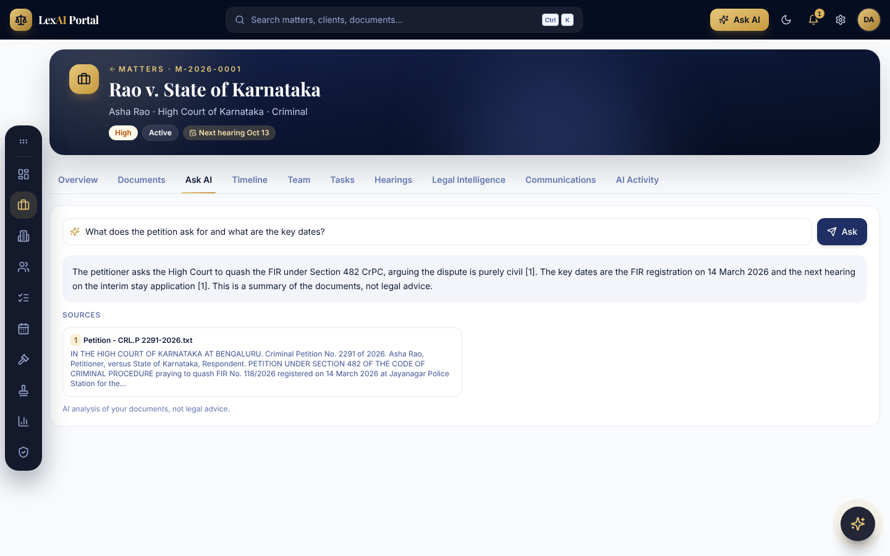
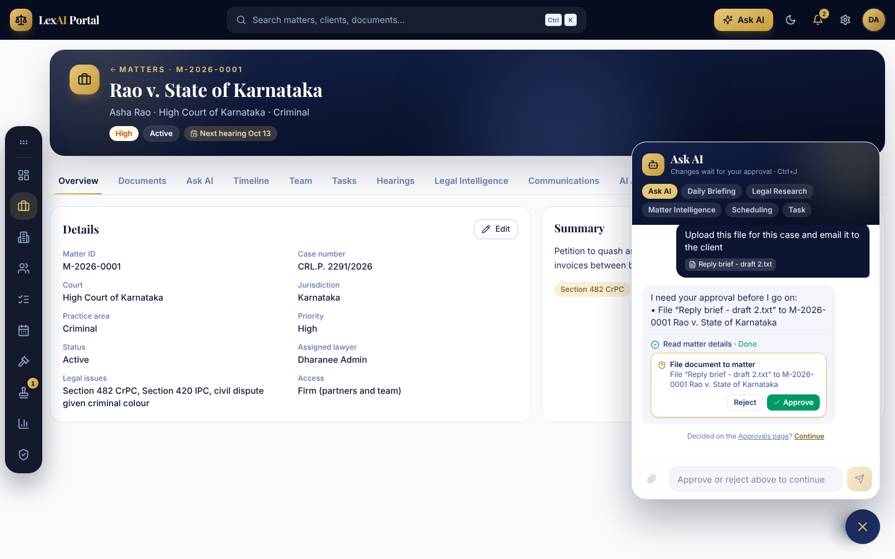
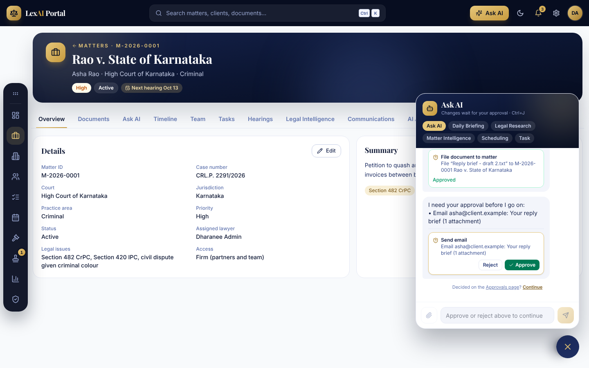
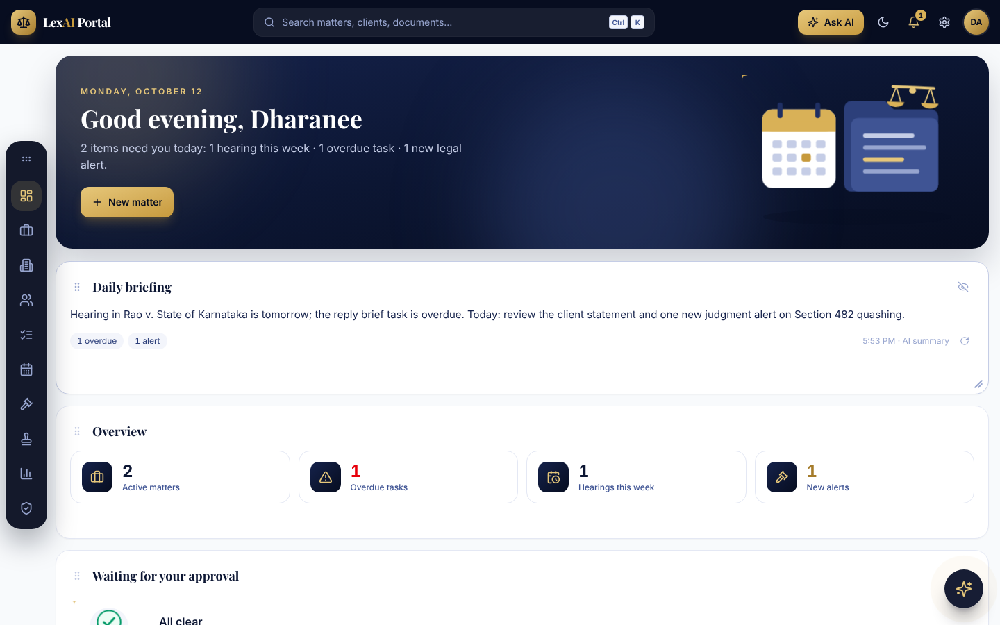
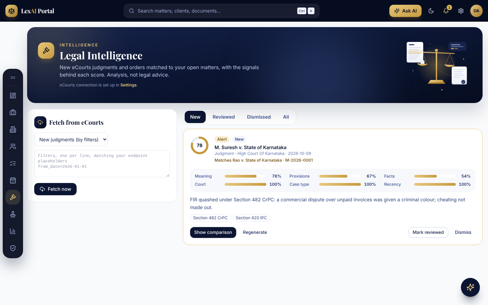
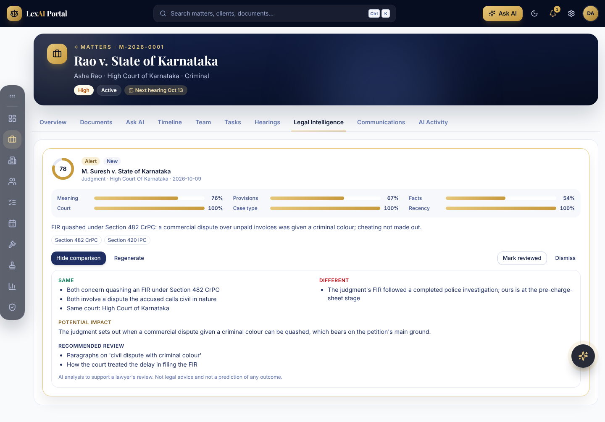
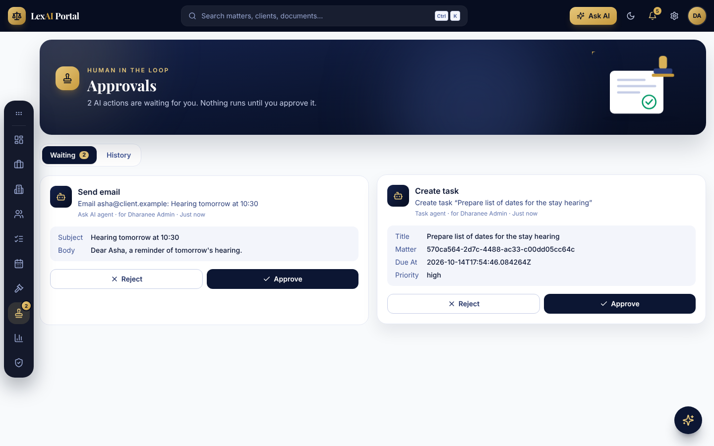
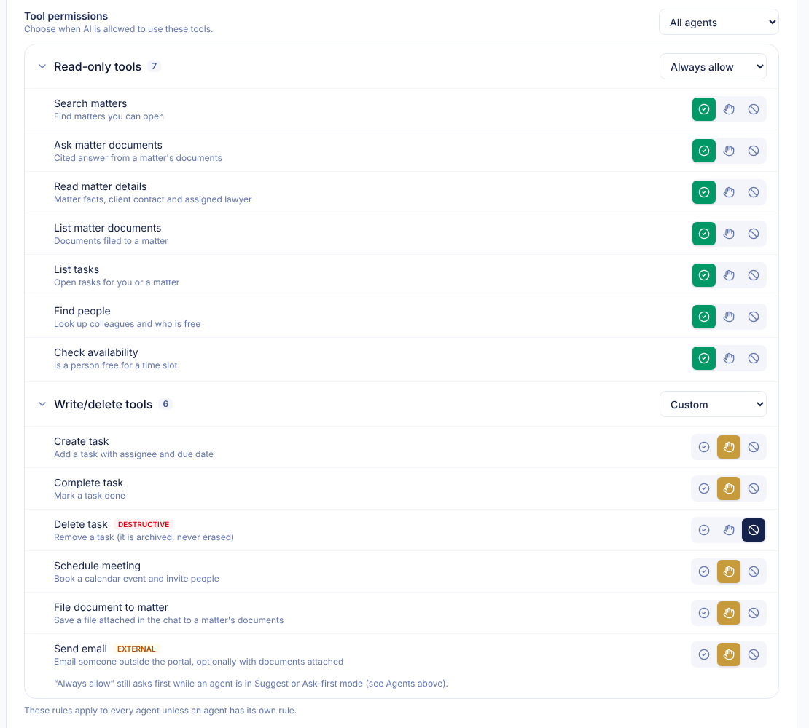
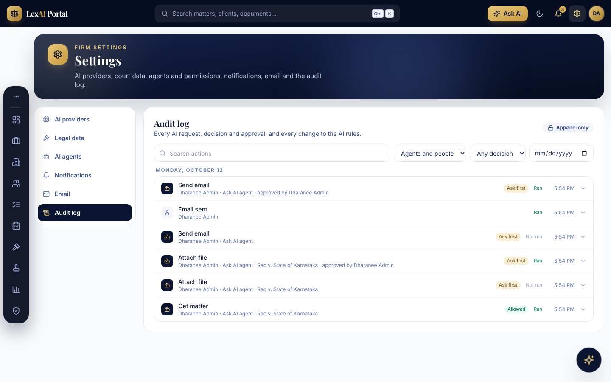
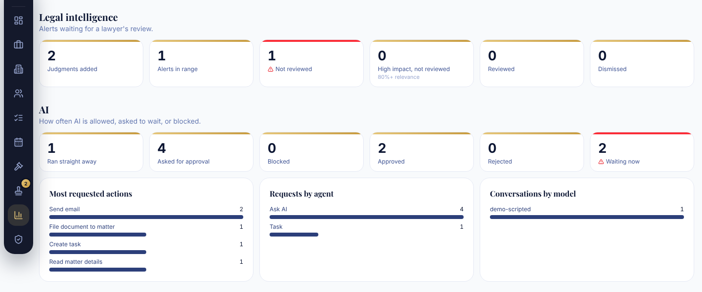

# AI Law Firm Intelligence & Matter Management Portal

Local-development prototype: FastAPI + PostgreSQL (pgvector) backend, React + Vite frontend.
See [TRACKER.md](TRACKER.md) for the full feature list and status, and
[CLAUDE.md](CLAUDE.md) for the complete project context (scope, architecture rules, roadmap).

## Project tracker spreadsheet
[docs/Project-Tracker.xlsx](docs/Project-Tracker.xlsx) tracks every task with status, priority, dependencies, owner and target date.
- **Summary**: live counts and % done per area and per sprint, plus open items needing input.
- **Frontend**, **Backend**, **AI**: one row per task. Change the Status dropdown (Done / In Progress / Not Started / Blocked) and the Summary updates.

[TRACKER.md](TRACKER.md) remains the feature-level view; the spreadsheet is the detailed task list.

### Google Sheets tracker
- [Project Tracker spreadsheet](https://docs.google.com/spreadsheets/d/12W3UFdPmQwounF4CWLC8Exx52Ok5wfOF8g0BiOdKelQ/edit?usp=sharing): the main shared tracker.
  To refresh it from the repo, use File > Import > Upload `docs/Project-Tracker.xlsx` > Replace spreadsheet.
- Reference copies: [Feature Tracker (FE + BE + AI)](https://docs.google.com/spreadsheets/d/1qH6SFYa37LD5dRy3VkaqZYHzw0c0AJ8RDApE7ve7oms/edit) (39 features) and [Task Tracker](https://docs.google.com/spreadsheets/d/1VahdEvdO0KcKf6t4uX9FrloDXqiNDcRRYhCYxDMmJZc/edit) (92 tasks).

## What it does
A web portal for a law firm. Lawyers keep their clients, cases (called *matters*), documents, tasks and court
hearings in one place, and AI helps them read, track and act on that work. The AI never acts on its own say-so:
the firm sets the rules, and anything that changes data or contacts someone waits for a person to approve it.

## What the AI can do
Screenshots below are from the real app running with sample data. A scripted stand-in model wrote the AI text,
because no AI provider is connected yet; with a real model the screens are the same and the answers come from it.

### 1. Ask questions about a case's documents
Upload a petition, contract or order to a matter, then ask a question in plain words. The AI answers **only from those
documents** and shows which file each part of the answer came from. If the documents do not say, it says so instead of
guessing. It explains documents; it does not give legal advice or predict results.



### 2. Ask AI assistant that can do the work for you
Open **Ask AI** (top bar, or Ctrl/Cmd + J) and type what you need, for example
*"Upload this file for this case and email it to the client"*. Attach the file with the paperclip. The assistant
works step by step: it reads the case, finds the client's email, files the document, then prepares the email.

Every step that changes something stops and asks you first, right inside the chat:

| Step 1: it asks before filing the document | Step 2: it asks before sending the email | Done |
|---|---|---|
|  |  |  |

Click **Approve** and it carries on. Click **Reject** and it stops and tells you what it did not do. It can also list
your tasks, add or complete tasks, check who is free and book meetings.

### 3. Daily briefing
Each morning (at the time you choose in your profile) the AI writes a short note on what needs you today: hearings,
overdue work, today's tasks and new court alerts. It uses only facts from the portal.



### 4. Court judgment alerts (Legal Intelligence)
The portal fetches new judgments and orders from eCourts and checks them against your open cases. Each match gets a
score and shows **why** it matched: similar meaning, the same legal sections, similar facts, the same court, case type
and how recent it is. Strong matches become alerts.



### 5. "My case vs this judgment" comparison
On a match, click **Compare with my case**. The AI lists what is the same, what is different, why it might matter, and
which parts to read. It is a reading aid for the lawyer, not a prediction.



### 6. Approvals page
Every AI action that is waiting for a person is listed here with exactly what will happen (who gets the email, the
task title and due date). Nothing runs until someone approves it.



### 7. Tool permissions: the firm decides what AI may do
Admins choose, tool by tool, whether the AI may **always** use it, must **ask first**, or is **blocked**. Read-only
tools (search, read, list) and write/delete tools (create, file, email, delete) are grouped, and rules can apply to all
agents or to one agent. Each agent also has a mode (Suggest, Ask first, Autonomous), and a **kill switch** stops every
AI change at once. These checks run on the server, so the AI itself can never change its permissions.



### 8. Audit log and AI analytics
Every AI request, the rule that applied, who approved it and what happened is written to a log that cannot be edited
or deleted. Analytics show how often AI ran, waited for approval or was blocked, and which actions are used most.

| Audit log | AI analytics |
|---|---|
|  |  |

### Safety rules the AI always follows
- It answers from your documents and cites them; no guessing.
- It never gives legal advice and never predicts a case outcome.
- It cannot give itself permission: the server checks role, case access, firm rules and the kill switch on every step.
- Changes and emails wait for approval by default; deleting is off by default, and "delete" only archives.
- Your AI and email passwords are stored encrypted and never sent to the browser.

### What you need before the AI works
In **Settings > AI providers**, add a model that can call tools (for the assistant) and an embedding model (for document
search). In **Settings > Legal data**, add the eCourts connection. In **Settings > Email**, add your mail server so
the assistant can send email.

## Prerequisites
- Python 3.11+
- Node 20+
- PostgreSQL 15+ with the `pgvector` extension installed
- An OpenAI-compatible LLM + embedding endpoint (e.g. Ollama, LM Studio, OpenAI) for Ask AI

## 1. Database
```sql
CREATE DATABASE ai_law;
\c ai_law
CREATE EXTENSION IF NOT EXISTS vector;
```

## 2. Backend (http://localhost:8000)
```powershell
cd backend
python -m venv .venv
.venv\Scripts\activate            # macOS/Linux: source .venv/bin/activate
pip install -r requirements.txt
copy ..\.env.example .env         # macOS/Linux: cp ../.env.example .env
```
Edit `backend/.env`: set `DATABASE_URL` and `SECRET_KEY`
(generate with `python -c "import secrets;print(secrets.token_urlsafe(48))"`).

Create the schema (the initial migration is in the repo; it also enables the pgvector extension):
```powershell
alembic upgrade head
```

The first admin is created in the browser on first run (see **First use**). For scripted setups you can seed instead:
```powershell
python -m app.seed admin@firm.com "YourPassword" "Admin Name"
```

Run the API:
```powershell
uvicorn app.main:app --reload
```
Check `http://localhost:8000/api/health` (interactive docs at `/docs`).

## 3. Frontend (http://localhost:5173)
```powershell
cd frontend
npm install
npm run dev
```
Vite proxies `/api` to `http://localhost:8000`. To point elsewhere, create `frontend/.env`
with `VITE_API_URL=http://localhost:8000`.

## 4. First use
1. Open http://localhost:5173. On an empty database you are taken to **Register your firm**: enter the firm name and
   create the admin account. (If you seeded an admin, just sign in.)
2. Open **Team & access** (admin only) and add your lawyers and staff. Each gets a one-time invite link (valid 7 days)
   to set their own password at `/register`, or you can give a temporary password. Roles, disabling access and reset
   links are managed from the same screen. Links are copied and sent by the admin; email delivery comes with the email integration.
3. Go to **Settings** and enter the LLM / embedding provider (base URL, model, API key), then use Test.
4. Create a client and a matter under **Matters**, upload a PDF/DOCX/TXT in the Documents tab,
   then ask questions in the **Ask AI** tab.

## Run the tests
```powershell
cd backend
.venv\Scripts\activate
pip install -r requirements-dev.txt   # first time only
pytest
```
The suite creates a separate `ai_law_test` database on the same Postgres server (dropped and rebuilt from the
migrations on every run), so your working data is never touched. It covers tasks, hearings, calendar, people,
reminders, the briefing, the AI policy engine, approvals, kill switch, overrides, agents (with a scripted model),
the append-only audit log, firm settings and analytics.

## Configuration
LLM, embedding and eCourts credentials are entered in the Settings page and stored
encrypted in the database. They are never sent to the browser. Only DB, secret key,
CORS origins, storage dir and embedding dimension (default 768) come from `.env`.

## Project status (summary)
| Area | Status |
|---|---|
| Setup | Done |
| Sprint 1: login, roles, clients, matters, documents, document Q&A | Done |
| Sprint 2: eCourts judgments, matching, comparison, alerts | Built; tested against a sample feed. Scheduled sync not built |
| Sprint 3: tasks, calendar, hearings, people, briefing, notifications | Done |
| Sprint 4: AI agents, Ask AI assistant, approvals, tool permissions, kill switch | Done; tested with a scripted model |
| Sprint 5: AI settings, model routing, email, audit log, analytics | Mostly done; storage, retention and API-key settings pending |

See [TRACKER.md](TRACKER.md) for the full list.
